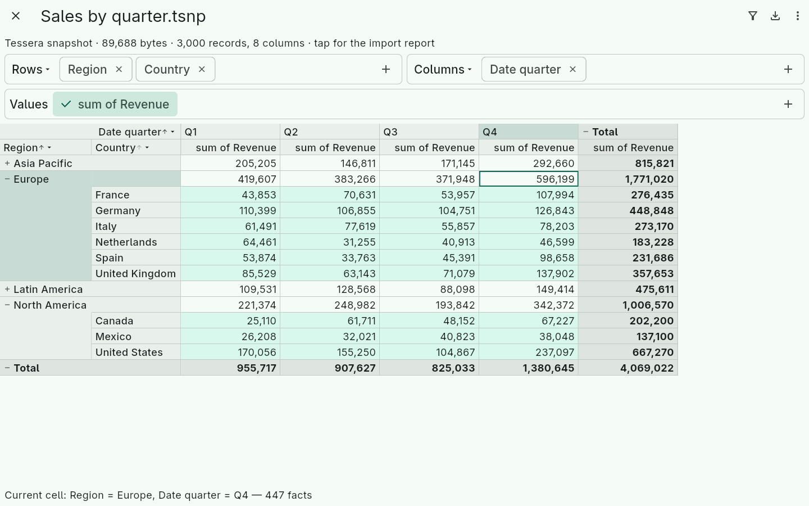
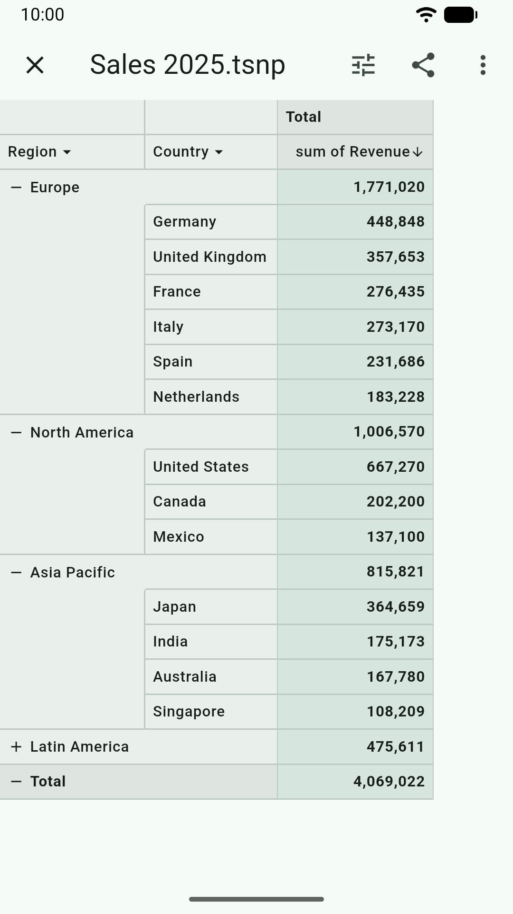
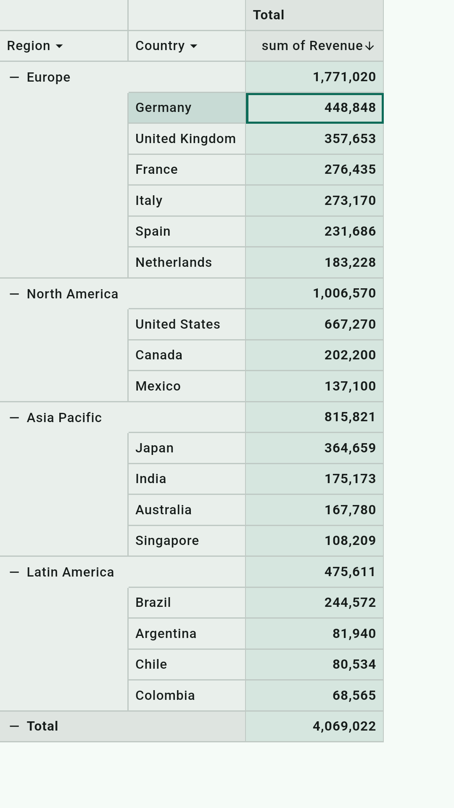
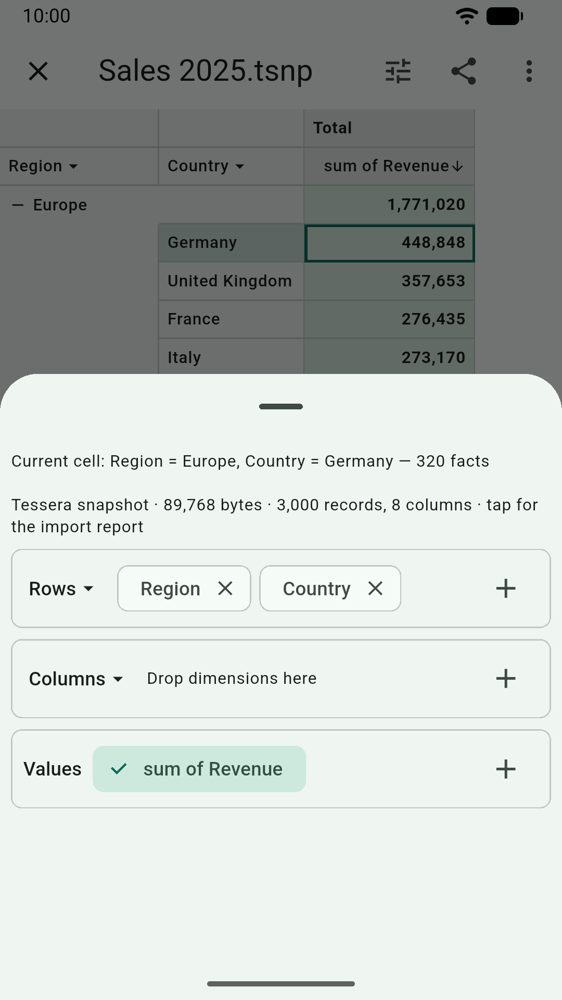
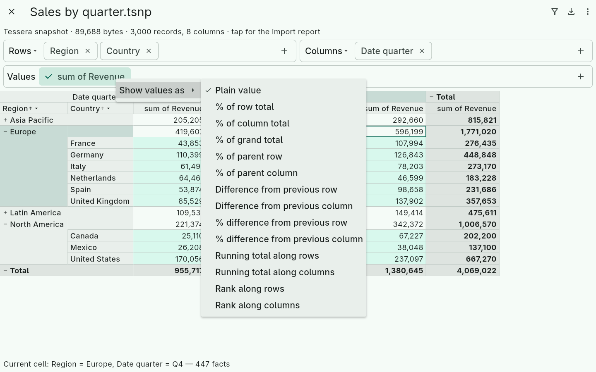
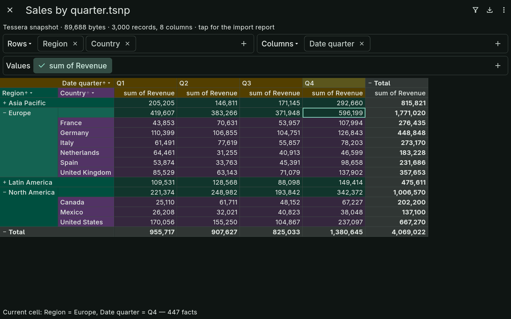

# Tessera Studio

[](https://github.com/nagylzs/tessera-studio/actions/workflows/ci.yml)

Open a CSV, Excel, OpenDocument or JSON file and see it as a pivot table
at once: group rows and columns, open and close the levels, add sums,
counts and averages, filter and sort — then save or share the result as
an Excel workbook, a PDF, a web page or another format.

**Free and ad-free, forever.** No ads, no in-app purchases, no
subscriptions, no account, no analytics, no tracking. Your files are
read on your device and never changed; the app goes online only when you
open a web address or a link yourself
([privacy policy](https://nagylzs.eu/tessera-studio/privacy/)).



> **Not released yet.** Tessera Studio is coming to Google Play, the
> App Store, the Mac App Store and the Microsoft Store at once, with a
> portable Windows build, Linux and the web besides. Until then you can
> build it yourself (below).

## What it does

A viewer, not an editor — to tables what an image viewer is to
pictures: open a file, see it as a pivot, save or send what you need.

**Open**
- CSV and tab-separated text (the separator is detected), Excel
  (`.xlsx`), OpenDocument (`.ods`), JSON and JSON Lines, and Tessera
  snapshots (`.tsnp`)
- from the file picker, from other apps ("Open with" and the share
  sheet on Android, "Open with" in Explorer with the Windows package —
  the other platforms follow), by drag and drop on Windows, Linux and
  the web, as a command-line argument, or from the clipboard: a web
  address, or cells copied from a spreadsheet
- column types, labels, dates and number formats are detected; adjust
  them once and they are remembered for every file with the same columns

**Explore**
- rows and columns in nested levels that open and close
- sums, counts, averages, minimums, maximums, distinct counts, standard
  deviations and your own formulas
- values as a percentage of a total, differences, running totals and
  ranks
- filters, and sorting by labels or by values
- a file you open again comes back on the pivot you left it on
- full screen on phones: tap a value to hide everything but the grid

**Save and share**
- the pivot as shown, in Excel, OpenDocument, PDF, HTML, SVG, CSV, JSON
  or JSON Lines
- the underlying rows as a plain table in Excel, OpenDocument, CSV or
  JSON Lines
- a Tessera snapshot: the data and the pivot in one file that reopens
  exactly as it was

**Make it yours**
- six grid styles, from a classic spreadsheet look to high contrast;
  the exports follow the style you choose
- light and dark themes
- 14 languages: Chinese, Czech, Dutch, English, French, German,
  Hungarian, Italian, Japanese, Polish, Portuguese, Russian, Spanish and
  Turkish

<p>
  
  
  
</p>





## Platforms

| Platform | State |
|----------|-------|
| Android | tested on a tablet (Android 16) and the emulator; Google Play coming |
| Windows | portable build tested; Microsoft Store package coming |
| Linux | a tarball and a `.deb` for x64 and arm64 (Ubuntu 22.04, Debian 12 or newer), with the menu entry and "Open with"; installed and tested by CI on Ubuntu 22.04 and 24.04 and Debian 12; on the GitHub Release at launch |
| Web | builds |
| iOS, macOS | tested on an iPhone 14 and a Mac mini (TestFlight); App Store coming |

Every push is analyzed, tested and built for all six platforms by
[CI](.github/workflows/ci.yml).

## Built on tessera

The pivot engine, the grid, the editors and every exporter come from
[tessera](https://github.com/nagylzs/tessera), an open-source pivot
table library for Dart and Flutter
([tessera](https://pub.dev/packages/tessera),
[tessera_flutter](https://pub.dev/packages/tessera_flutter) and the
exporters on pub.dev). Its
[user guide](https://github.com/nagylzs/tessera/blob/main/docs/README.md)
explains pivots, aggregates, formulas, filters and exports in depth;
everything in it applies here.

## Building

```bash
flutter pub get
flutter run -d linux        # or -d chrome, -d windows, -d macos, a device
flutter test
flutter build linux --release     # or windows, macos, web, apk, appbundle, ios
```

To work on the tessera packages and the app at the same time, point the
app at a local checkout of tessera next to it with a
`pubspec_overrides.yaml` (ignored by git):

```yaml
dependency_overrides:
  tessera:
    path: ../tessera/packages/tessera
  tessera_flutter:
    path: ../tessera/packages/tessera_flutter
  tessera_xlsx:
    path: ../tessera/packages/tessera_xlsx
  tessera_ods:
    path: ../tessera/packages/tessera_ods
  tessera_html:
    path: ../tessera/packages/tessera_html
  tessera_svg:
    path: ../tessera/packages/tessera_svg
  tessera_pdf:
    path: ../tessera/packages/tessera_pdf
```

The committed `pubspec.yaml` always depends on the published versions;
do not commit a `pubspec.lock` resolved through the overrides.

`store/` holds what the app stores need besides the builds: the privacy
policy, the listing texts in all 14 languages, and the screenshots with
their demo data (`dart run tool/demo_data.dart`).

## Translations

English is the original, and the author reviews the Hungarian texts. The
other twelve languages were translated by AI and may read unnaturally in
places. Corrections from native speakers are very welcome:

- open an [issue](https://github.com/nagylzs/tessera-studio/issues) with
  the language, where the text appears, its current wording and your
  suggestion, or
- edit the texts in a pull request: `lib/l10n/app_<code>.arb` for the
  app's own texts, `store/listing/<code>.yaml` for the store
  descriptions. The grid, the editors and the exports take their texts
  from tessera, in
  [`packages/tessera/lib/src/l10n/l10n_<code>.dart`](https://github.com/nagylzs/tessera/tree/main/packages/tessera/lib/src/l10n).

## Feedback

Bugs and ideas: [GitHub issues](https://github.com/nagylzs/tessera-studio/issues).
Other questions: apps@nagylzs.eu.

## License

MIT — see [LICENSE](LICENSE). Author: László Zsolt Nagy.
